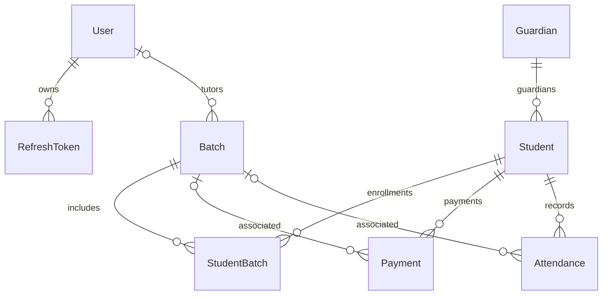

# Database and shared-contract model

**Last reviewed:** 2026-10-14 
**Source of truth:** active [`schema.prisma`](../../packages/db/prisma/schema.prisma), the six tracked SQL migration files under [`migrations`](../../packages/db/prisma/migrations/), and shared package exports under [`packages/shared/src`](../../packages/shared/src). Migration files were inspected statically; the migration state of a live database was not checked.

## Active persisted model

| Model | Current meaning and notable constraints |
| --- | --- |
| [`User`](../../packages/db/prisma/schema.prisma) | Admin/staff account; unique email, name, password hash, role, timestamps. One user may tutor batches and own refresh tokens. |
| [`RefreshToken`](../../packages/db/prisma/schema.prisma) | Stores a unique hashed refresh token, expiry, optional IP/user-agent, and revocation timestamp; cascades with its user. |
| [`Guardian`](../../packages/db/prisma/schema.prisma) | Contact record with unique email and optional phone; one guardian may relate to multiple students. It has no login identity. |
| [`Student`](../../packages/db/prisma/schema.prisma) | Learner identity/contact record; optional unique email/phone/school name and required guardian relation. |
| [`Batch`](../../packages/db/prisma/schema.prisma) | Group/course-like record with name, optional subject/teacher, start/end dates, and optional tutor. |
| [`StudentBatch`](../../packages/db/prisma/schema.prisma) | Student-to-batch join record with unique `(studentId, batchId)`, agreed total fee, and join date. |
| [`Payment`](../../packages/db/prisma/schema.prisma) | Manually recorded amount, date, method and notes; student required, batch optional. The model has no invoice, provider transaction, or settlement relation. |
| [`Attendance`](../../packages/db/prisma/schema.prisma) | Date/status/notes for a student and optional batch; unique `(studentId, batchId, date)`. |

The active schema contains **8 models, 3 enums, and 9 explicit `@relation` fields**. The tracked migration history has **6 SQL migrations**. The final tracked migration adds `AttendanceStatus.None` and makes `Attendance.status` nullable, matching the active schema enum and field optionality; this source comparison does not establish which migrations have been applied to any deployed database.

## Enums

- [`UserRole`](../../packages/db/prisma/schema.prisma): `ADMIN`, `STAFF`.
- [`AttendanceStatus`](../../packages/db/prisma/schema.prisma): `Present`, `Absent`, `Late`, `None`.
- [`PaymentMethod`](../../packages/db/prisma/schema.prisma): `Cash`, `UPI`, `Stripe`, `BankTransfer`, `Card`, `Other`. An enum value does not establish that a payment processor integration exists.

## Cross-app contract boundary

[`packages/shared/src/schemas/`](../../packages/shared/src/schemas) exports Zod contracts for auth, users, students, guardians, batches, enrollment, payments, and attendance. `common.ts` provides shared validation primitives and Prisma-backed enum schemas. [`packages/shared/src/types/index.ts`](../../packages/shared/src/types/index.ts) defines response/enriched types using Prisma client types. Backend DTOs wrap shared Zod schemas; the frontend consumes shared payload/response types.

Coverage count: **9 shared schema modules**, **17 named declarations in the shared types file**, and **3 enum exports** from the shared enum barrel. The shared package barrels are `packages/shared/src/schemas.ts`, `packages/shared/src/enums/index.ts`, and `packages/shared/src/index.ts`.

The Prisma schema uses the active `prisma-client` generator. The repository also contains [`@erp/prisma-zod-v4`](../../packages/prisma-zod-v4/src/index.ts), whose custom generator is not configured as active in this schema; do not treat its default output path as the source of the currently exported schemas.

## Important missing dimensions

- No institution/organization/tenant identifier is present on any model. Current persistence does not demonstrate cross-institution data isolation.
- There are no class session/calendar, timetable, invoice, recurring fee plan, guardian/student account, notification, audit trail, file/document, or tenant configuration models in this active schema.
- Database field types and relations describe storage, not a validated commercial or legal requirement. Decide target-market needs before extending the model.
