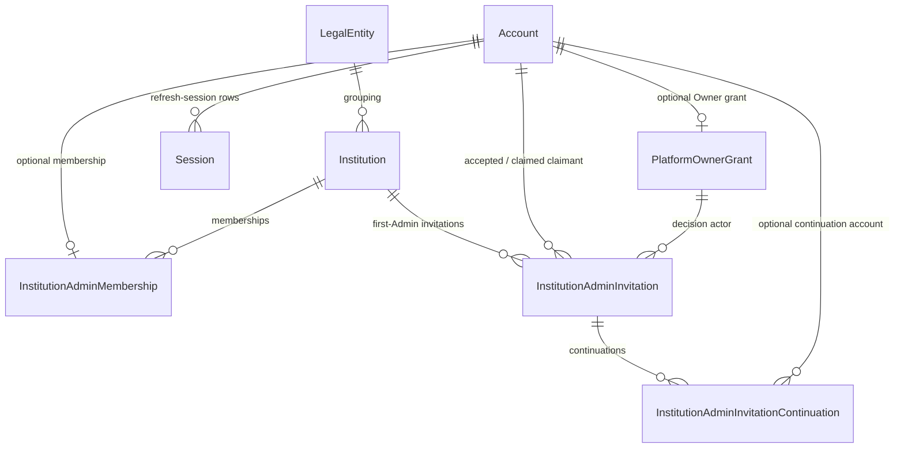

# Database and shared-contract model

**Last reviewed:** 2026-11-02 
**Repository state:** `review/delivered-feature-portfolio` at HEAD `ac672771194f7c96892ba73ff56d4b1ba8ad684d`. 
**Persistence source of truth:** active [`schema.prisma`](../../packages/db/prisma/schema.prisma) and tracked SQL migrations under [`migrations`](../../packages/db/prisma/migrations/). 
**Contract source of truth:** active public barrels under [`packages/shared/src`](../../packages/shared/src). 
This review inspected schema and migration source only. No database was connected to, queried, migrated, or reset.

## Active models, enums, and relations

The active schema has **8 models, 2 enums, and 14 explicit `@relation(...)` annotations**. Its authorization/onboarding relation map is:

| Model | Implemented fields/shape and relationships |
| --- | --- |
| [`Account`](../../packages/db/prisma/schema.prisma#L27) | UUID ID, globally unique email, password hash, `identity_kind`, timestamps, composite unique `(id, identity_kind)`. Optional `PlatformOwnerGrant` and `InstitutionAdminMembership`; many sessions, accepted/claimed invitations, and continuations. |
| [`PlatformOwnerGrant`](../../packages/db/prisma/schema.prisma#L43) | Account ID primary key, Owner identity-kind discriminator, grant time; composite relation to Account and many invitation decision references. Grant presence plus Owner identity is checked for current Owner authorization. |
| [`Session`](../../packages/db/prisma/schema.prisma#L54) | Account ID, rotation-family ID, unique refresh-token hash, creation/expiry/revocation timestamps; account and expiry indexes plus rotation-family index. Account deletion cascades. |
| [`LegalEntity`](../../packages/db/prisma/schema.prisma#L68) | UUID ID, name, nullable unique code for preserved legacy rows, timestamps; one-to-many Institution relation. New Owner creation supplies a code. |
| [`Institution`](../../packages/db/prisma/schema.prisma#L77) | Required LegalEntity FK, name, nullable code suffix for legacy compatibility, timestamps; unique LegalEntity/suffix pair, LegalEntity index, and membership/invitation collections. LegalEntity deletion is restricted. |
| [`InstitutionAdminMembership`](../../packages/db/prisma/schema.prisma#L91) | Account ID primary key, Admin identity-kind discriminator, Institution ID, creation time. Composite Account relation and Institution relation. The membership key permits at most one Institution membership per Account; the Institution index permits multiple Admin accounts per Institution. The schema does not enforce that every Account marked `INSTITUTION_ADMIN` has a membership, so the active auth/service checks also matter. |
| [`InstitutionAdminInvitation`](../../packages/db/prisma/schema.prisma#L105) | Institution ID, unique bearer-token hash, nullable invited email/contact fields, status and expiry, claim/review/decision fields, optional accepted/claimed Accounts, optional deciding Owner grant, status-credential hash/expiry, and continuation collection. Institution/status/time and foreign-key indexes are declared in the schema. |
| [`InstitutionAdminInvitationContinuation`](../../packages/db/prisma/schema.prisma#L142) | Invitation ID, unique continuation credential hash, optional Account ID, CSRF-token hash, creation/expiry/revocation/consumption timestamps. Cascades on deletion of invitation or related Account. |

The active enums are [`AccountIdentityKind`](../../packages/db/prisma/schema.prisma#L11) (`UNASSIGNED`, `PLATFORM_OWNER`, `INSTITUTION_ADMIN`) and [`InstitutionAdminInvitationStatus`](../../packages/db/prisma/schema.prisma#L17) (`PENDING`, `PENDING_APPROVAL`, `APPROVED`, `REJECTED`, `REVOKED`, `EXPIRED`, `LEGACY_ACCEPTED`). `LEGACY_ACCEPTED` preserves old accepted records as distinct from the current Owner-approved claim flow.

The migration set contains five SQL migrations:

1. `20261028210927_platform_owner_identity_session_baseline`
2. `20261029012600_add_legal_entity_institution`
3. `20261029132500_institution_admin_onboarding`
4. `20261029161100_claim_owner_review`
5. `20261029231851_institution_onboarding_codes_and_recipient_email`

The invitation migration contains a PostgreSQL-specific partial unique index for one outstanding invitation/claim per Institution; this index is expressed in SQL rather than as a Prisma `@@unique`. Migration file presence and ordering do not establish application to any environment. The feature-delivery record reports a clean replay of the current five-file chain on a newly provisioned disposable database on 2026-11-02. This architecture review did not repeat that operation. The same record reports that local `erp_platform_dev` retains a removed migration entry; this database and its ledger were not inspected here. All other environment migration states are unknown.

## Shared public schemas and types

- [`packages/shared/src/index.ts`](../../packages/shared/src/index.ts) exports the public [`schemas.ts`](../../packages/shared/src/schemas.ts) barrel.
- The public barrel re-exports four schema modules: [`auth.ts`](../../packages/shared/src/schemas/auth.ts), [`health.ts`](../../packages/shared/src/schemas/health.ts), [`institution-onboarding.ts`](../../packages/shared/src/schemas/institution-onboarding.ts), and [`institution-admin-onboarding.ts`](../../packages/shared/src/schemas/institution-admin-onboarding.ts). Together these define **48 exported inferred type aliases**.
- Public export does not mean every declared contract has an active consumer. For example, `institutionPairCreateSchema` and its paired response/list schemas remain exported from `institution-onboarding.ts`, but the active Owner endpoints use separate LegalEntity creation and Institution-plus-invitation contracts; no active caller of the former pair-creation schemas was found. `platformOwnerSignInSchema` remains consumed by the bootstrap command, while active workspace login uses `signInRequestSchema`; legacy-shaped Owner account/sign-in response schema declarations remain in the public module, while the logout response schema is still used by the active auth controller/service.
- The schema source directory contains **13 modules**. Nine source modules are not public schema-module exports: `attendance`, `batch`, `common`, `enrollment`, `guardian`, `payment`, `primitives`, `student`, and `user`. `institution-onboarding.ts` selectively re-exports primitive contract definitions; inactive source files do not establish active APIs.
- `packages/shared/src/enums/index.ts` is not exported through the root shared barrel. The separate [`@erp/prisma-zod-v4` generator](../../packages/prisma-zod-v4/src/index.ts) is not configured in the active schema; the schema configures the Prisma client generator.

## Implemented tenancy and invitation boundaries

- An Institution belongs to exactly one LegalEntity; a LegalEntity can group multiple Institutions. LegalEntity is metadata/grouping in this implementation, not the authorization boundary.
- Each membership names one Institution, and the Account primary key on membership permits at most one membership per account. The active approval service creates the membership and sets the Admin identity together; current auth/guard checks also reject an inconsistent identity/membership pair. Owner and Institution Admin identities are distinct. Invitation claim is persisted separately from approval; current service code grants Admin identity/membership on Owner approval.
- Institution and invitation ownership is represented in the active schema. However, there are no operational education-data models or active institution-scoped business queries/controllers. The presence of a membership model/guard alone does not demonstrate tenant isolation for business records.
- First-Admin invitations contain addressed recipient/contact data; active source returns a one-time URL for manual sharing and has no email-delivery integration. Continuation and status credentials are represented by hashes in persisted models.
- Approved onboarding/security decisions and historical choices are recorded in [`institution-onboarding-foundation.md`](../product/feature-delivery/institution-onboarding-foundation.md). That record is the authority for product decisions; this catalog describes only the current schema/source and does not imply production readiness.

## Scope and exclusions

Generated Prisma client output, `dist`, dependencies, and retained legacy business schemas/enums are excluded. The active schema does not define Student, Guardian, User/Staff, Batch, Enrollment, Attendance, Payment, campus, external integration, or additional staff-management models. No migration/test/build command or live database inspection was performed during this review.
