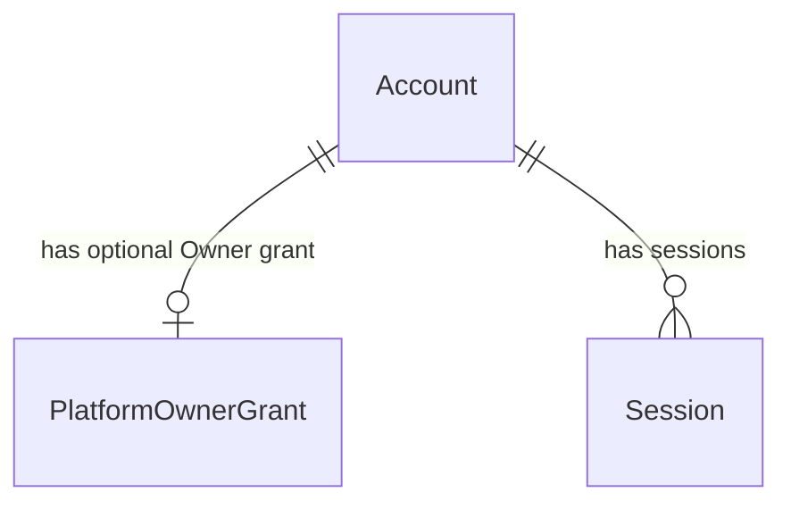

# Database and shared-contract model

**Last reviewed:** 2026-10-29 
**Persistence source of truth:** active [`schema.prisma`](../../packages/db/prisma/schema.prisma) and tracked SQL migrations under [`migrations`](../../packages/db/prisma/migrations/). 
**Contract source of truth:** active public barrels under [`packages/shared/src`](../../packages/shared/src). 
Migration files were inspected statically. This architecture review did not inspect live database state or identify the database behind the user's reported local Owner login; migration application state remains unknown.

## Active persisted models

| Model | Current meaning and constraints |
| --- | --- |
| [`Account`](../../packages/db/prisma/schema.prisma) | Platform Owner account with UUID string ID, globally unique email, password hash, and creation/update timestamps. It has an optional one-to-one `PlatformOwnerGrant` and zero or more `Session` rows. |
| [`PlatformOwnerGrant`](../../packages/db/prisma/schema.prisma) | Owner authority record keyed by `account_id`, which is both its primary key and a required FK to `Account`; deleting the account cascades to the grant. Grant presence is the current Owner authorization signal. |
| [`Session`](../../packages/db/prisma/schema.prisma) | Session ID, required `account_id`, unique refresh-token hash, creation/expiry timestamps, and nullable revocation timestamp. Account deletion cascades to sessions. Indexes cover `account_id` and `expires_at`. |

The active schema has **3 models, 0 enums, and 2 explicit `@relation` fields**. Its single tracked migration is [`20261028210927_platform_owner_identity_session_baseline`](../../packages/db/prisma/migrations/20261028210927_platform_owner_identity_session_baseline/migration.sql). It creates the three tables, the unique email and refresh-token-hash indexes, the account/expiry indexes, and cascading foreign keys from grant/session to Account. The file's presence does not establish that it has been applied to any database.

There is no `Institution`, `LegalEntity`, tenant membership, invitation, institution ID, or operational business model in the current schema. The approved product direction describes Institution as the future authorization boundary and LegalEntity as grouping metadata; neither entity nor its model-specific fields, relation cardinality, constraints, or lifecycle is defined by the active schema.

## Enums and shared contracts

- The active Prisma schema declares **no enums**. The `packages/shared/src/enums/index.ts` source re-exports business enums, but that module is not re-exported by the active `@erp/shared` root barrel.
- `packages/shared/src/schemas/` contains **9 schema source modules**. The public [`schemas.ts`](../../packages/shared/src/schemas.ts) barrel exports only [`schemas/auth.ts`](../../packages/shared/src/schemas/auth.ts), which defines `platformOwnerSignInSchema` and the inferred `PlatformOwnerSignInPayload`.
- [`types/index.ts`](../../packages/shared/src/types/index.ts) declares three response interfaces: `PlatformOwnerAccountResponse`, `PlatformOwnerSignInResponse`, and `PlatformOwnerLogoutResponse`. The root shared barrel exposes those types and the active schemas.
- The remaining legacy business schema source files are not proof of current API contracts: they are not exported by the active schema barrel and the corresponding business APIs are not active.
- The active Prisma schema configures the `prisma-client` generator. The separate [`@erp/prisma-zod-v4`](../../packages/prisma-zod-v4/src/index.ts) package is not configured in the schema and is not evidence that shared Zod contracts are generated.

## Slice 2 data-design recommendation (not yet user-approved)

The user approved continuing to the planned Slice 2: create the first Institution and LegalEntity grouping. Previously approved cross-slice decisions remain: shared schema; one institution per account; Platform Owner authority remains separate from institution membership; Institution is the intended authorization boundary; LegalEntity is grouping metadata only; no Platform Owner tenant-data access; and legacy business APIs remain inactive.

The Data Contracts Engineer's completed design-only handoff recommends the following model. This is a recommendation, **not an implemented schema or an approved design**:

| Proposed entity | Proposed shape |
| --- | --- |
| `Institution` | Generated ID, required name, timestamps. |
| `LegalEntity` | Generated ID, required Institution FK `institution_id`, required name, timestamps; index the FK. |
| Relationship | One Institution to many LegalEntities; each LegalEntity belongs to exactly one Institution. Owner setup creates the Institution and its first LegalEntity atomically. |
| Constraints/lifecycle | No global or per-Institution name uniqueness absent an approved business rule. Restrict hard deletion of an Institution. No membership, invitation, or Account-to-Institution relation in Slice 2. |

The Architecture Analyst recommends this 1:N direction because it supports future grouping without making LegalEntity an authorization boundary; one-to-one is more restrictive, and many-to-many is not justified by a stated shared-entity use case. Atomic creation matches the approved initial setup flow. `Restrict` protects the tenant root but requires an explicit deletion/retention path. Avoiding unrequested name uniqueness preserves flexibility but requires the user to confirm duplicate-name behavior.

The recommendation is cross-layer: Platform Owner UI creates the pair and displays its result; the API authorizes the operation from the current Owner session/grant and persists both records atomically; shared request/response contracts live in `@erp/shared` and do not expose server-only Prisma types; the migration adds the proposed tables/FK/index to the baseline. No membership, invitation, email delivery, or institution operational-data access is introduced in this slice. Endpoint path and exact contract shape remain open.

**User approval is pending.** The user must approve or revise: (1) 1:N cardinality and whether an initial LegalEntity is required at creation versus whether every Institution must retain one; (2) exact fields and name validation/length/normalization; (3) deletion/retention and creator audit; (4) duplicate-name policy; (5) retry/idempotency behavior; and (6) request/response shape and server-owned IDs. Migration applicability also depends on confirming target environment state; this review did not inspect any database. Until explicit user architecture/data-design approval, the proposal must not be implemented.

## Constraints and open facts

- Current Platform Owner auth data is global and not institution-scoped. No tenant isolation property is established by the current models or routes.
- The fresh-start baseline is tracked; no existing or deployed database may be assumed to have that baseline, and no migration was run during this refresh.
- The active schema stores credentials and sessions but no user-agent, IP address, tenant ID, invitation, or business data.
- Business models and enums visible only in legacy source/generated artifacts are excluded from the active model count. Generated Prisma clients and package `dist` output are not schema sources and were not edited.
- Deletion/retention policy, name rules, jurisdiction/regulatory requirements, and future multi-institution query patterns remain open for user decision; this recommendation does not resolve them.
