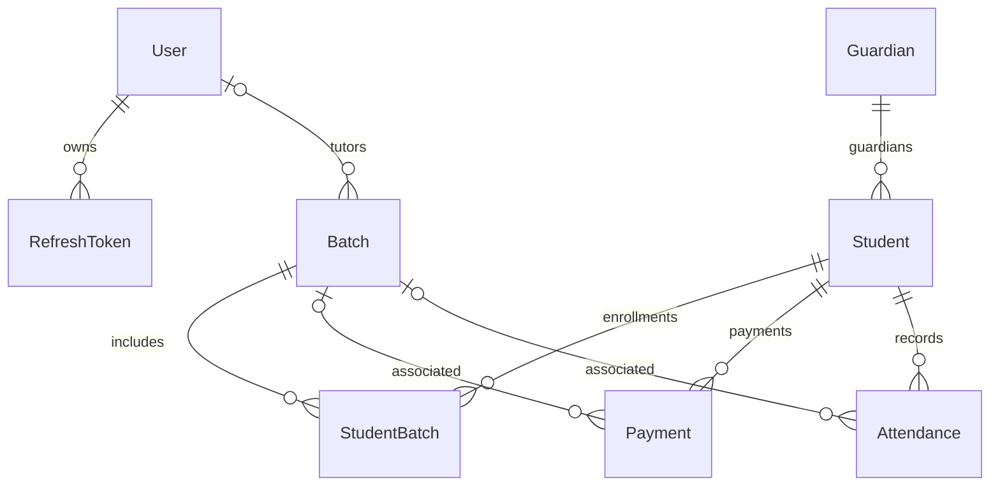

# Database and shared-contract model

**Last reviewed:** 2026-10-14 
**Source of truth:** `packages/db/prisma/schema.prisma` and the shared package exports under `packages/shared/src`.

## Active persisted model

| Model | Current meaning and notable constraints |
| --- | --- |
| `User` | Admin/staff account; unique email, name, password hash, role, timestamps. One user may tutor batches and own refresh tokens. |
| `RefreshToken` | Stores a unique hashed refresh token, expiry, optional IP/user-agent, and revocation timestamp; cascades with its user. |
| `Guardian` | Contact record with unique email and optional phone; one guardian may relate to multiple students. It has no login identity. |
| `Student` | Learner identity/contact record; optional unique email/phone/school name and required guardian relation. |
| `Batch` | Group/course-like record with name, optional subject/teacher, start/end dates, and optional tutor. |
| `StudentBatch` | Student-to-batch join record with unique `(studentId, batchId)`, agreed total fee, and join date. |
| `Payment` | Manually recorded amount, date, method and notes; student required, batch optional. The model has no invoice, provider transaction, or settlement relation. |
| `Attendance` | Date/status/notes for a student and optional batch; unique `(studentId, batchId, date)`. |

## Enums

- `UserRole`: `ADMIN`, `STAFF`.
- `AttendanceStatus`: `Present`, `Absent`, `Late`, `None`.
- `PaymentMethod`: `Cash`, `UPI`, `Stripe`, `BankTransfer`, `Card`, `Other`. An enum value does not establish that a payment processor integration exists.

## Cross-app contract boundary

`packages/shared/src/schemas/` exports Zod contracts for auth, users, students, guardians, batches, enrollment, payments, and attendance. `common.ts` provides shared validation primitives and Prisma-backed enum schemas. `packages/shared/src/types/index.ts` defines response/enriched types using Prisma client types. Backend DTOs wrap shared Zod schemas; the frontend consumes shared payload/response types.

The Prisma schema uses the active `prisma-client` generator. The repository also contains `@erp/prisma-zod-v4`, whose custom generator is not configured as active in this schema; do not treat its default output path as the source of the currently exported schemas.

## Important missing dimensions

- No institution/organization/tenant identifier is present on any model. Current persistence does not demonstrate cross-institution data isolation.
- There are no class session/calendar, timetable, invoice, recurring fee plan, guardian/student account, notification, audit trail, file/document, or tenant configuration models in this active schema.
- Database field types and relations describe storage, not a validated commercial or legal requirement. Decide target-market needs before extending the model.
