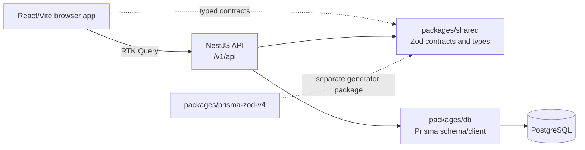

# System overview

**Last reviewed:** 2026-10-14 
**Scope:** tracked application source, active Prisma schema, shared contracts, package manifests, and route definitions. Generated output and reusable `src/components/ui` primitives are excluded from the business-feature count.

## Runtime and package map

| Workspace | Implemented responsibility | Evidence |
| --- | --- | --- |
| `apps/frontend` | React 19/Vite app; React Router routes are generated from `src/pages`; Redux Toolkit Query calls the API; Tailwind/shadcn-style UI components | [`main.tsx`](../../apps/frontend/src/main.tsx), [`vite.config.ts`](../../apps/frontend/vite.config.ts), [`vite-plugin-file-routes.ts`](../../apps/frontend/vite-plugin-file-routes.ts), [`api-slice.ts`](../../apps/frontend/src/api/api-slice.ts) |
| `apps/backend` | NestJS modules/controllers/services; Zod request validation; JWT/local authentication; role guards; Prisma/PostgreSQL access | [`main.ts`](../../apps/backend/src/main.ts), [`AppModule`](../../apps/backend/src/app.module.ts), [`auth`](../../apps/backend/src/auth), [`domains`](../../apps/backend/src/domains), [`features`](../../apps/backend/src/features), [`PrismaService`](../../apps/backend/src/core/prisma.service.ts) |
| `packages/db` | PostgreSQL Prisma schema, migrations and generated-client package | [`schema.prisma`](../../packages/db/prisma/schema.prisma), [`package.json`](../../packages/db/package.json) |
| `packages/shared` | Shared Zod schemas, payload types, response types and enum exports | [`index.ts`](../../packages/shared/src/index.ts), [`schemas`](../../packages/shared/src/schemas), [`types/index.ts`](../../packages/shared/src/types/index.ts) |
| `packages/prisma-zod-v4` | A custom Prisma-to-Zod generator package | [`src/index.ts`](../../packages/prisma-zod-v4/src/index.ts); its custom generator is not enabled in the active Prisma schema |

## Runtime flow

- The frontend's [RTK Query `apiSlice`](../../apps/frontend/src/api/api-slice.ts) uses the shared [base query](../../apps/frontend/src/api/base-query.ts) and injects feature endpoints from `src/features/**`.
- The backend [bootstrap](../../apps/backend/src/main.ts) enables Helmet, cookie parsing, CORS, a Prisma exception filter, and Swagger; [AppModule](../../apps/backend/src/app.module.ts) configures global Zod validation/serialization. Its global API prefix is `/v1/api`.
- The backend connects through [`PrismaService`](../../apps/backend/src/core/prisma.service.ts) using `@prisma/adapter-pg` and the `DATABASE_URL` environment value.
- The backend configures local and JWT Passport strategies. Domain/feature controllers generally apply `JwtAuthGuard` and `RolesGuard`; actual role declarations are listed in the [API catalog](api-catalog.md).
- The app currently defines `ADMIN` and `STAFF` roles. Student and guardian records are not login accounts in the Prisma model.

## Application surface

The frontend has 15 tracked page/layout files: 12 route pages (`/`, `*` (404 fallback), `/signin`, `/signup`, `/forgot-password`, `/dashboard`, `/users`, `/attendance`, `/batches`, `/batches/:id`, `/students`, and `/students/:id`) plus the app shell and two route-group layouts. The file-route generator in [`vite-plugin-file-routes.ts`](../../apps/frontend/vite-plugin-file-routes.ts) omits the `(app)` and `(auth)` grouping directories from public paths and maps `404.tsx` to `*`. The landing page is static marketing content with a static AI demo and unverified social-proof/integration claims; no demo-request API workflow was found. The eight business feature directories are auth, attendance, batches, dashboard, enrollment, payments, students, and users. A separate root-level bug-report form is not a feature directory and is not connected to a backend workflow. Generated route output and reusable `src/components/ui` primitives are excluded from feature counts.

The backend has 10 controllers and 38 route handlers. Its 10 non-root modules are `AuthModule`, `CoreModule`, `UsersModule`, `StudentsModule`, `GuardiansModule`, `BatchesModule`, `EnrollmentModule`, `PaymentsModule`, `AttendanceModule`, and `DashboardModule`; `AppModule` wires them together. They cover health, authentication, CRUD-style domain APIs, attendance/enrollment/payments, and dashboard aggregates. See the [full route and role inventory](api-catalog.md). The login controller declares throttle metadata, but source does not establish that a throttling guard is active; details are recorded in the API catalog and bug triage.

## Integration and deployment boundaries

- The browser calls the API through RTK Query and `VITE_API_BASE_URL` (default `http://localhost:3000/v1/api`). The API uses Prisma with the PostgreSQL adapter and requires `DATABASE_URL`. Shared Zod schemas and types are imported by the frontend and backend.
- Authentication in tracked source uses local credentials, JWTs, and refresh-token cookies. No external identity-provider integration was found in the reviewed backend source.
- The active payment workflow records payment data manually. `PaymentMethod.Stripe` is an enum member, not evidence of a Stripe client, webhook, or payment-processing integration.
- Tracked Vercel build configuration exists for both apps (`apps/backend/vercel.json`, `apps/frontend/vercel.json`); the backend also lists fixed Vercel frontend origins in CORS. These files establish repository configuration only, not a live deployment or its version.
- No external school-information-system, learning-management-system, messaging, or payment-provider client/route was found in the inspected application source and package manifests. Runtime integrations outside this repository remain unknown.

## Audit coverage

| Area | Coverage recorded | Notes |
| --- | --- | --- |
| Backend routes/modules | 10 controllers, 38 handlers; 10 non-root modules plus `AppModule` | All tracked controllers, module wiring, guards, and role metadata under `apps/backend/src` were inspected. |
| Frontend routes | 15 page/layout files: 12 route pages and 3 app/layout files | All tracked files under `apps/frontend/src/pages` were inspected; generated router output is excluded. |
| Frontend business features | 8 feature directories plus 1 standalone bug-report form | Reusable `src/components/ui` primitives are excluded from the business-feature count. |
| Persistence | 8 active Prisma models, 3 enums, 9 explicit relation fields; 6 SQL migrations | `schema.prisma` and all tracked SQL migrations were inspected. Applied migration state on any live database was not checked. |
| Shared contracts | 9 schema modules, 17 named shared type declarations, 3 exported enums | Shared schema sources and public barrels under `packages/shared/src` were inspected. |
| Tests | 1 active backend Jest spec with 3 test cases; 1 commented-out e2e spec; no frontend test script | Source inventory only. The user-reported run/build/deployment is recorded in [bug triage](../product/bug-triage.md); it was not independently run or verified in this audit. |

## Current architectural constraints and open decisions

- There is no `Organization`, `School`, `Tenant`, or campus model and no tenant identifier in the listed business records. The current code therefore does not demonstrate institution-level data isolation. Whether this is acceptable depends on the single-organization versus multi-tenant SaaS model and must be decided before onboarding multiple organizations into one deployment.
- There are no student/guardian login identities, notification/communication models, class-session schedule model, invoice/fee-plan model, audit-event model, or external payment-provider integration in the active schema and route inventory.
- Vercel build configuration is tracked for both apps, but this review did not establish a live production deployment, its environment/version, database migration state, backup, observability, or incident-response readiness.
- No customer research, usage analytics, pricing data, or geography-specific regulatory decision is present in the repository.

These are observations about the current repository, not decisions that those capabilities must be built.
