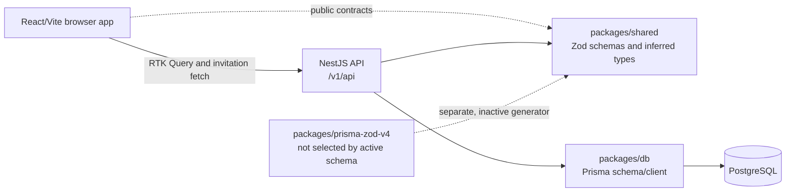

# System overview

**Last reviewed:** 2026-11-02 
**Repository state:** `review/delivered-feature-portfolio`, HEAD `ac672771194f7c96892ba73ff56d4b1ba8ad684d` (merge commit for PR #8; `dev` and `origin/dev` pointed to this commit during review). Worktree was clean before this documentation update. 
**Scope:** active tracked frontend/backend source, workspace manifests/configuration, active Prisma schema and tracked migrations, shared-contract source/barrels, tests, and documented integration/deployment boundaries. No build, test, or database command was run for this review. Generated output, dependencies, and reusable UI primitives are excluded from business-feature counts.

## Runtime and package map

| Workspace | Active implementation and boundary |
| --- | --- |
| `apps/frontend` | React/Vite SPA, file-derived routes, Redux/RTK Query, session state, and feature pages/components. Route source is `src/pages`; the three active feature directories are `auth` (cross-cutting), `owner`, and `institution-admin-invitation`. [`vite-plugin-file-routes.ts`](../../apps/frontend/vite-plugin-file-routes.ts) generates `src/router.generated.ts`; generated output is excluded from counts and was not edited. |
| `apps/backend` | NestJS application. [`AppModule`](../../apps/backend/src/app.module.ts) imports `CoreModule`, `AuthModule`, and `OwnerModule`, and mounts `HealthController`. Active source has four controllers and 18 controller-declared handlers. |
| `packages/db` | PostgreSQL Prisma schema, five tracked SQL migrations, Prisma client generation, and the PostgreSQL adapter used by [`PrismaService`](../../apps/backend/src/core/prisma.service.ts). |
| `packages/shared` | Active public Zod contracts and inferred types. The root barrel exports four schema modules; other business-schema files remain source but are not part of the active root exports. |
| `packages/prisma-zod-v4` | A separate generator implementation. The active Prisma schema selects `prisma-client`, not this generator; package presence does not indicate generated public contracts. |

## Request, identity, and persistence flow

- The frontend API base defaults to `http://localhost:3000/v1/api` and may be configured with `VITE_API_BASE_URL` ([`base-query.ts`](../../apps/frontend/src/api/base-query.ts)). RTK Query handles workspace auth and Owner directory/status calls; invitation continuation uses the active invitation client.
- The backend bootstrap applies Helmet, cookie parsing, configured CORS, the Prisma exception filter, `/v1/api`, and Swagger at `/v1/api/docs` ([`main.ts`](../../apps/backend/src/main.ts)). Global Zod validation and response serialization are configured in [`AppModule`](../../apps/backend/src/app.module.ts).
- CORS source contains `http://localhost:5173`, `https://erp-platform-frontend.vercel.app`, `https://erp-platform-frontend-anubhav11803451s-projects.vercel.app`, plus configured `CLIENT_URL` ([`main.ts`](../../apps/backend/src/main.ts)). Actual production origin/cookie topology is not established by this repository review. Auth and invitation routes additionally compare the request's exact Origin with configured `CLIENT_URL`.
- [`PrismaService`](../../apps/backend/src/core/prisma.service.ts) connects through `@prisma/adapter-pg` and `DATABASE_URL`. The active schema contains eight identity/onboarding models. It has no Student, Guardian, Batch, Enrollment, Attendance, Payment, or operational education-data model.
- One `/signin` UI and `POST /v1/api/auth/login` serve ordinary Platform Owner and approved Institution Admin sessions. The server derives identity from the Account identity, Owner grant, or Institution Admin membership. Invitation continuation uses an explicit login intent on the same endpoint and does not create a workspace session ([`AuthController`](../../apps/backend/src/auth/auth.controller.ts), [`AuthService`](../../apps/backend/src/auth/auth.service.ts), [`auth.ts`](../../packages/shared/src/schemas/auth.ts)).
- Owner provisioning is an out-of-band [`bootstrap:owner` command](../../apps/backend/src/commands/bootstrap-platform-owner.command.ts), not public sign-up. It requires the Account table to be empty and creates the Account plus Owner grant transactionally.
- A Platform Owner creates a coded LegalEntity, then separately creates an Institution and its addressed first-Admin invitation in one transaction ([`OwnerService`](../../apps/backend/src/owner/owner.service.ts)). The bearer is returned once in a URL fragment for manual sharing; active source has no invitation email delivery.
- A claimant may use an existing eligible account or establish a new account through the addressed invitation. Claim records `PENDING_APPROVAL`, not membership. A separate Owner decision transaction grants the fixed Institution Admin identity and membership on approval. The claimant signs in separately; rejection/revocation/expiry do not grant membership. Source stores decision actor/time but not proof or details of the approved out-of-band identity check.
- `InstitutionAdminMembership` and an `InstitutionAdminJwtAuthGuard` exist, but no active operational business controller consumes that guard or an institution-scoped operational query. The Institution page is an authenticated account/Institution overview, not an operational ERP workspace.
- `AuthModule` starts an in-process continuation cleanup service that sweeps hourly after startup and deletes unconsumed expired/revoked continuations after a 24-hour retention delay. Consumed continuation rows are excluded by its query; longer-term retention/cleanup policy is not established here.

## Active frontend journeys

There are **9 tracked page/layout source files** under `apps/frontend/src/pages`, yielding **6 route paths**:

| Path | Active source behavior |
| --- | --- |
| `/` | Static marketing page (`pages/page.tsx`); demo CTAs have no active demo-submission API. Marketing claims are not evidence of delivered integrations or AI functionality. |
| `/signin` | Shared workspace sign-in (`pages/(auth)/signin/page.tsx`). Role-specific destination follows the backend-returned identity. Public registration is not exposed. |
| `/owner` | Authenticated Platform Owner LegalEntity/Institution directory, Institution creation, first-Admin invitation, and claim review controls. |
| `/institution` | Authenticated Institution Admin account/Institution summary only. |
| `/invite/admin` | Invitation bearer exchange, existing/new-account claim, claim-status resumption, and outcome states. |
| `*` | Not-found page. |

The other three page-tree files are `_app.tsx` and the `(auth)` and `(app)` layouts. Parenthesized groups are layout-only route groups; route generation behavior is defined in [`vite-plugin-file-routes.ts`](../../apps/frontend/vite-plugin-file-routes.ts). The active `src/features` tree has **3 feature directories** (`auth`, `owner`, `institution-admin-invitation`) and 21 source files. `bug-report-form.tsx` is a standalone disconnected file, not a feature directory or routed capability. Reusable `src/components/ui` primitives are excluded.

## Backend, legacy source, and coverage boundary

The active Nest tree has **4 modules counting `AppModule`** (`AppModule`, `AuthModule`, `CoreModule`, `OwnerModule`), **4 controllers**, and **18 handlers**. [`api-catalog.md`](api-catalog.md) lists every active controller route with method and access behavior.

`apps/backend/legacy-reference/` contains **43 retained files**, including eight old business controllers/modules for Batches, Guardians, Students, Users, Attendance, Dashboard, Enrollment, and Payments. `apps/frontend/legacy-reference/` contains **38 retained files**, including old business pages/features. They are excluded from active route/feature counts unless active imports or module wiring prove otherwise; current root `AppModule` does not import those legacy modules. The active tree's three feature directories are separate from these reference sources.

Count reconciliation inspected `apps/frontend/src/pages`, `src/features`, route generation/configuration and active imports; active backend modules/controllers/handlers and guard/strategy wiring; the full active Prisma schema and migration directory; shared source modules and public barrels; package/test/config files; and tracked Vercel/environment examples. `node_modules`, `dist`, generated Prisma client output, generated router output, and reusable UI primitives were excluded from source/business counts. The detailed feature-by-feature status and evidence are in [`docs/product/feature-inventory.md`](../product/feature-inventory.md).

## Integrations, deployment, tests, and unresolved facts

- Active persistence uses PostgreSQL. Repository configuration references `DATABASE_URL`, `CLIENT_URL`, `JWT_SECRET`, `BACKEND_PORT`, and frontend `VITE_API_BASE_URL`; cookie names and SameSite behavior have environment configuration. [`.env.example`](../../.env.example) contains placeholders only.
- [`apps/backend/vercel.json`](../../apps/backend/vercel.json) and [`apps/frontend/vercel.json`](../../apps/frontend/vercel.json) describe repository deployment build/rewrite configuration. They do not prove a deployment, its current source/version, environment, database, or release status.
- No active source/client or workspace dependency for external identity, email delivery, payment processing, SIS/LMS, or webhook integration was found. The landing page's AI/integration copy is not evidence that such a service is connected.
- Active backend test source has **12 unit `*.spec.ts` files / 50 `it`/`test` cases**. A separate PostgreSQL integration spec has **5 cases** and requires an explicitly acknowledged disposable database. `apps/backend/test/app.e2e-spec.ts` is commented out. The frontend declares no test script and has no test source in this scope. No tests were run for this review.
- The feature-delivery record reports a clean five-migration replay and five passing PostgreSQL integration cases on a newly provisioned disposable database, plus a limited isolated browser acceptance on 2026-11-02. Those are prior reported verification results, not checks repeated here. This review did not inspect any live database or run the application.
- Migration application to any shared or production database, runtime configuration, deployment state, production rate-limit topology, external/proxy logging, backups, monitoring, operator recovery, customer use, geography, and regulatory requirements remain unverified. The feature record reports a local database with a removed migration recorded in its ledger; that database was not inspected here.
- Source implementation is merged at `ac67277` on the reviewed `dev` refs. Merge status does not establish deployment, release, feature enablement, or user validation.

## Coverage summary

| Area | Audited source scope | Reconciled count |
| --- | --- | --- |
| Frontend routes/pages | `apps/frontend/src/pages`, Vite route plugin/config | 9 page/layout files; 6 paths |
| Frontend feature directories | `apps/frontend/src/features` and active page imports | 3 directories; 21 source files; standalone bug-report form excluded |
| Backend routes/modules | `apps/backend/src` controller/module wiring | 4 controllers; 18 handlers; 4 modules including root |
| Legacy reference | `apps/backend/legacy-reference`, `apps/frontend/legacy-reference` | 43 backend files; 38 frontend files; not active capability counts |
| Active persistence | `packages/db/prisma/schema.prisma`, migration tree | 8 models; 2 enums; 14 explicit relation annotations; 5 SQL migrations |
| Shared contracts | `packages/shared/src`, active root/schema barrels | 13 schema modules; 4 publicly re-exported modules; 48 exported inferred type aliases |
| Automated test source | Backend Jest unit/integration specs and frontend package/scripts | 12 unit spec files / 50 cases; 1 integration spec / 5 cases; commented e2e; no frontend test runner |
