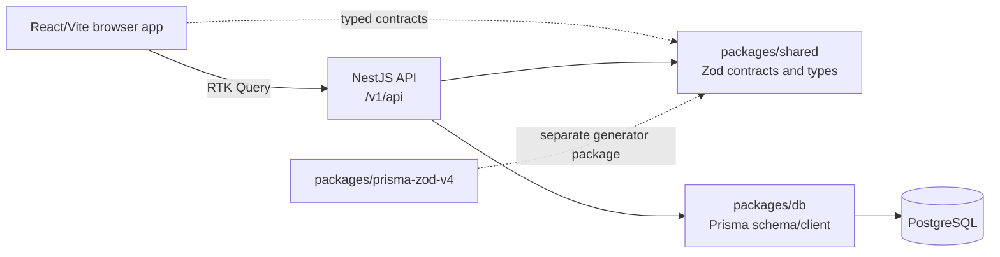

# System overview

**Last reviewed:** 2026-10-14 
**Scope:** tracked application source, active Prisma schema, shared contracts, package manifests, and route definitions. Generated output and reusable `src/components/ui` primitives are excluded from the business-feature count.

## Runtime and package map

| Workspace | Implemented responsibility | Evidence |
| --- | --- | --- |
| `apps/frontend` | React 19/Vite app; React Router routes are generated from `src/pages`; Redux Toolkit Query calls the API; Tailwind/shadcn-style UI components | `apps/frontend/src/main.tsx`, `vite.config.ts`, `vite-plugin-file-routes.ts`, `src/api/api-slice.ts` |
| `apps/backend` | NestJS modules/controllers/services; Zod request validation; JWT/local authentication; role guards; Prisma/PostgreSQL access | `apps/backend/src/main.ts`, `src/app.module.ts`, `src/auth/`, `src/domains/`, `src/features/`, `src/core/prisma.service.ts` |
| `packages/db` | PostgreSQL Prisma schema, migrations and generated-client package | `packages/db/prisma/schema.prisma`, `packages/db/package.json` |
| `packages/shared` | Shared Zod schemas, payload types, response types and enum exports | `packages/shared/src/index.ts`, `src/schemas/`, `src/types/index.ts` |
| `packages/prisma-zod-v4` | A custom Prisma-to-Zod generator package | `packages/prisma-zod-v4/src/index.ts`; its custom generator is not enabled in the active Prisma schema |

## Runtime flow

- The frontend's RTK Query `apiSlice` uses the shared base query and injects feature endpoints from `src/features/**`.
- The backend bootstrap enables Helmet, cookie parsing, CORS, a Prisma exception filter, Zod validation/serialization, and Swagger. Its global API prefix is `/v1/api`.
- The backend connects through `PrismaService` using `@prisma/adapter-pg` and the `DATABASE_URL` environment value.
- The backend configures local and JWT Passport strategies. Domain/feature controllers generally apply `JwtAuthGuard` and `RolesGuard`; actual role declarations are listed in the [API catalog](api-catalog.md).
- The app currently defines `ADMIN` and `STAFF` roles. Student and guardian records are not login accounts in the Prisma model.

## Application surface

The frontend has 15 page/layout files: root/landing and not-found routes; sign-in, sign-up, and forgot-password; plus the authenticated dashboard, user management, attendance, batch list/detail, and student list/detail. The landing page contains generic ERP marketing, static AI demo output, unverified social-proof/integration claims, and demo buttons without a connected sales workflow. Business feature folders cover auth, users, students, batches, enrollment, payments, attendance, and dashboard. A bug-report form component exists but is not connected to a backend workflow.

The backend has 10 controllers and 38 route handlers, including health, authentication, CRUD-style domain APIs, attendance/enrollment/payments, and dashboard aggregates. See the [full route and role inventory](api-catalog.md).

## Audit coverage

| Area | Coverage recorded | Notes |
| --- | --- | --- |
| Backend routes | 10 controllers, 38 handlers | All controllers under `apps/backend/src` were inspected; role metadata is represented in the API catalog. |
| Frontend routes | 15 page/layout files | Page routes and layouts under `apps/frontend/src/pages` were inspected. |
| Frontend business features | 8 feature folders plus bug-report form | Reusable UI primitives are excluded from the product feature count. |
| Persistence | 8 Prisma models, 3 enums | Active schema only; migration history was not treated as a product capability list. |
| Shared contracts | 9 schema modules plus shared type/enum exports | Schemas and public barrel exports under `packages/shared/src` were inspected. |
| Tests | Backend e2e spec is commented out; no frontend test script | Automated behavior coverage is not established by this inventory. |

## Current architectural constraints and open decisions

- There is no `Organization`, `School`, `Tenant`, or campus model and no tenant identifier in the listed business records. The current code therefore does not demonstrate institution-level data isolation. Whether this is acceptable depends on the single-organization versus multi-tenant SaaS model and must be decided before onboarding multiple organizations into one deployment.
- There are no student/guardian login identities, notification/communication models, class-session schedule model, invoice/fee-plan model, audit-event model, or external payment-provider integration in the active schema and route inventory.
- Deployment configuration files exist for the apps, but this review did not establish production deployment, backup, observability, or incident-response readiness.
- No customer research, usage analytics, pricing data, or geography-specific regulatory decision is present in the repository.

These are observations about the current repository, not decisions that those capabilities must be built.
