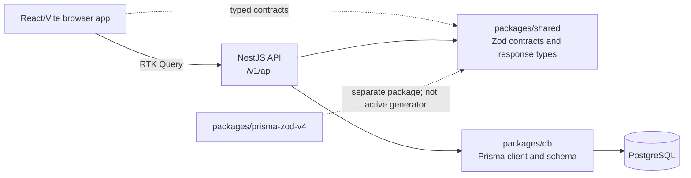

# System overview

**Last reviewed:** 2026-10-29 
**Repository state:** `feature/institution-onboarding-foundation`, local HEAD `68584c1` 
**Scope:** tracked frontend/backend source, workspace manifests, active Prisma schema/migration, and shared
contracts. Generated output, dependencies, and reusable `src/components/ui` primitives are excluded.
Legacy-reference source is counted as retained source, not as active application capability.

## Runtime and package map

| Workspace | Repository implementation | Evidence |
| --- | --- | --- |
| `apps/frontend` | React/Vite application, generated file routes, Redux Toolkit Query, auth/session state, and locally maintained UI components | [`main.tsx`](../../apps/frontend/src/main.tsx), [`vite.config.ts`](../../apps/frontend/vite.config.ts), [`vite-plugin-file-routes.ts`](../../apps/frontend/vite-plugin-file-routes.ts), [`api-slice.ts`](../../apps/frontend/src/api/api-slice.ts) |
| `apps/backend` | NestJS application; active `AppModule` imports config, Core/Prisma, and Auth, and mounts the health controller | [`main.ts`](../../apps/backend/src/main.ts), [`AppModule`](../../apps/backend/src/app.module.ts), [`AuthModule`](../../apps/backend/src/auth/auth.module.ts), [`CoreModule`](../../apps/backend/src/core/core.module.ts) |
| `packages/db` | PostgreSQL Prisma schema, one tracked baseline migration, and generated-client package scripts | [`schema.prisma`](../../packages/db/prisma/schema.prisma), [`migrations`](../../packages/db/prisma/migrations/), [`package.json`](../../packages/db/package.json) |
| `packages/shared` | Public Zod sign-in schema, inferred sign-in payload, and Platform Owner auth response types; older business schema source files are not exported by the active schema barrel | [`index.ts`](../../packages/shared/src/index.ts), [`schemas.ts`](../../packages/shared/src/schemas.ts), [`schemas/auth.ts`](../../packages/shared/src/schemas/auth.ts), [`types/index.ts`](../../packages/shared/src/types/index.ts) |
| `packages/prisma-zod-v4` | Separate custom generator package; no generator declaration in the active Prisma schema | [`src/index.ts`](../../packages/prisma-zod-v4/src/index.ts), [`schema.prisma`](../../packages/db/prisma/schema.prisma) |

## Request and persistence flow

- The frontend [RTK Query API slice](../../apps/frontend/src/api/api-slice.ts) uses the [base query](../../apps/frontend/src/api/base-query.ts), whose default API URL is `http://localhost:3000/v1/api` and may be overridden by `VITE_API_BASE_URL`.
- The [backend bootstrap](../../apps/backend/src/main.ts) enables Helmet, cookie parsing, credentialed CORS, the Prisma exception filter, Swagger at `/v1/api/docs`, and the `/v1/api` global prefix. [`AppModule`](../../apps/backend/src/app.module.ts) installs global Zod validation and serialization.
- [`PrismaService`](../../apps/backend/src/core/prisma.service.ts) connects through `@prisma/adapter-pg` and `DATABASE_URL`. The active Prisma schema has only Platform Owner identity/session tables; it has no Institution or LegalEntity model.
- Platform Owner sign-in, refresh, logout, and current-account calls use the shared auth contract and active [`AuthController`](../../apps/backend/src/auth/auth.controller.ts). The JWT strategy checks the current persisted session and `PlatformOwnerGrant`; an active Owner grant is not an institution membership.
- There are no active institution-scoped operational APIs, tenant memberships, or institution-data queries. No institution boundary can yet be exercised through the active application.

## Frontend application surface

The tracked `src/pages` tree contains **7 page/layout files** and generates four route paths:

| Route | Current source behavior |
| --- | --- |
| `/` | Static marketing landing page (`pages/page.tsx`); no demo-lead API workflow was found. |
| `/signin` | Platform Owner sign-in (`pages/(auth)/signin/page.tsx`). |
| `/owner` | Protected Platform Owner workspace with an institution-setup placeholder (`pages/(app)/owner/page.tsx`). |
| `*` | Not-found page (`pages/404.tsx`). |

The other three files are `_app.tsx` and the `(auth)` and `(app)` layout files. The [route generator](../../apps/frontend/vite-plugin-file-routes.ts) omits parenthesized groups from public paths and maps `404.tsx` to `*`; generated `router.generated.ts` is not counted as source.

There are **8 tracked, nonempty feature directories**: `auth` plus seven legacy business directories (`attendance`, `batches`, `dashboard`, `enrollment`, `payments`, `students`, `users`). Only the auth feature is connected to active routes and active auth APIs. The seven business directories retain UI source, but their former pages and API implementations are in `apps/frontend/legacy-reference/` and `apps/backend/legacy-reference/`; they are not current tenant-safe capabilities. `bug-report-form.tsx` is a standalone source file, not a feature directory, and is not connected to a page/API. Reusable UI primitives are excluded from the business-feature count.

## Backend routes, modules, and build boundary

The active Nest application has **2 controllers, 5 route handlers, and 2 non-root modules plus `AppModule`**. The routes, prefix, and access controls are listed in the [API catalog](api-catalog.md). Active modules are `AuthModule` and `CoreModule`; `AppModule` also mounts `HealthController`. No legacy business controller/module is imported by `AppModule`.

The configured Nest source root is `src`, but the build configuration has a mismatch that needs resolution: [`nest-cli.json`](../../apps/backend/nest-cli.json) explicitly selects `tsconfig.json`, while [`tsconfig.build.json`](../../apps/backend/tsconfig.build.json) is the file that excludes `legacy-reference`, specs, and test files. A read-only `tsc --project tsconfig.json --listFilesOnly` check included legacy-reference TypeScript, active specs, and `test/app.e2e-spec.ts`. The frontend has a similar coverage distinction: [`tsconfig.app.json`](../../apps/frontend/tsconfig.app.json) includes `src`, and a read-only `tsc --project tsconfig.app.json --listFilesOnly` check listed retained legacy business feature files as well as active imports. Vite's runtime bundle follows the active import graph, but the selected TypeScript project does not limit its file list to that graph.

The user subsequently reported that `pnpm --filter @erp/backend run build-local` passed; `pnpm dev` returned HTTP 200 for backend health and Owner login; and `pnpm --filter @erp/frontend exec vite build` passed. This is evidence of successful backend build/runtime routes and frontend bundling as reported, but does **not** show that legacy TypeScript inputs were excluded. The full frontend build/typecheck was not run in that verification. No build was run by this architecture refresh; do not treat successful bundling/runtime checks as proof of the desired TypeScript boundary.

## Persistence and shared-contract boundary

The active Prisma schema has **3 models, 0 enums, and 2 explicit `@relation` fields**; one SQL migration is tracked. See the [data-model catalog](data-model.md). Shared source contains 9 schema modules, but the public schema barrel exports only the auth schema; the shared type barrel defines 3 Platform Owner response interfaces. Legacy business schemas and enum re-exports remain in source but are not part of the active root `@erp/shared` exports. Generated Prisma output and `dist` are excluded from counts and were not edited.

## Integration, deployment, tests, and current constraints

- Active auth is local email/password, JWT access tokens, and refresh-token/CSRF cookies. No external identity provider or email-delivery client is evidenced in active source/manifests.
- No institution/LegalEntity create API, invitation-delivery service, payment-provider client, or external SIS/LMS integration is evidenced in the active route tree or backend modules. A `Stripe` value in old/legacy code does not establish a provider integration.
- Vercel configuration files are tracked for both apps (`apps/backend/vercel.json`, `apps/frontend/vercel.json`). They establish repository configuration only; deployment status/version, runtime environment, migration state, backups, observability, and production controls were not inspected.
- Three active backend Jest spec files contain five test cases; `apps/backend/test/app.e2e-spec.ts` is commented out. The frontend package has no test script. Tests were not run during this refresh.
- The approved product direction is a shared schema, one institution per account, Platform Owner access separate from institution membership, and LegalEntity as grouping metadata rather than an authorization boundary. The Data Contracts Engineer's model-specific 1:N Institution/LegalEntity proposal is now integrated in the [data-model gate](data-model.md); explicit user approval remains pending.
- The current source has no `Institution`, `LegalEntity`, tenant membership, or invitation model. The user-approved Slice 2 is not implemented and is not a runtime/deployment capability. The specialist design has been integrated as a recommendation; explicit architecture/data-design approval remains required before implementation.
- This Architecture Analyst refresh did not inspect live database state or identify the database behind the user's reported local Owner login. The tracked baseline migration does not prove which database has applied it. The intended production tenancy model outside the approved repository direction, target geography, customer usage, and runtime integrations remain unverified.

## Audit coverage

| Area | Reviewed scope and recorded count |
| --- | --- |
| Backend controllers/routes/modules | `apps/backend/src`; 2 controllers, 5 handlers, 2 non-root modules plus root `AppModule`. Legacy reference source is separately noted. |
| Frontend routes/pages | `apps/frontend/src/pages`; 7 page/layout files, 4 paths. Generated router output excluded. |
| Frontend business feature directories | `apps/frontend/src/features`; 7 retained business directories (inactive legacy), 1 active auth directory; standalone bug-report form excluded from directory count. UI primitives excluded. |
| Active persistence/migration | Active `schema.prisma` and tracked migrations; 3 models, 0 enums, 2 explicit relation fields, 1 SQL migration. |
| Shared contracts | `packages/shared/src`; 9 schema source modules, 1 public schema module, 3 response interfaces. Legacy source exports are distinguished from the active package barrel. |
| Automated test source | 3 active backend spec files / 5 test cases; 1 commented-out e2e file; no frontend test script. |
| Integration/deployment boundary | App source and manifests, `apps/*/vercel.json`, bootstrap/config; repository configuration only, not a live-service audit. |
